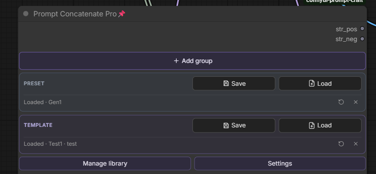
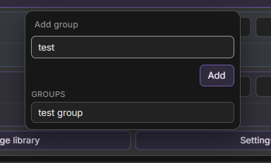
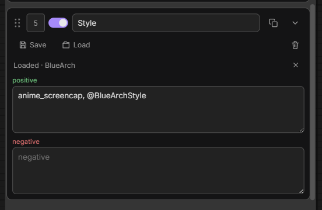
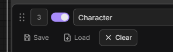
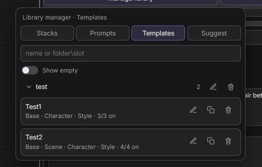
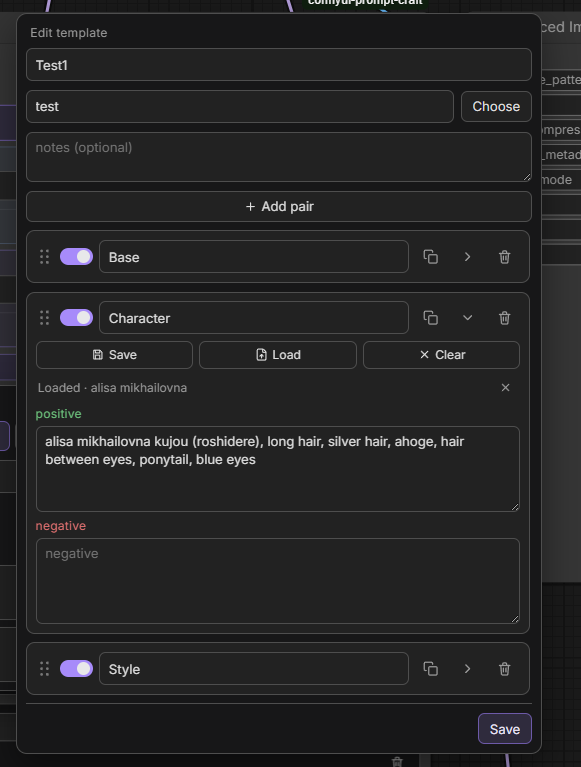
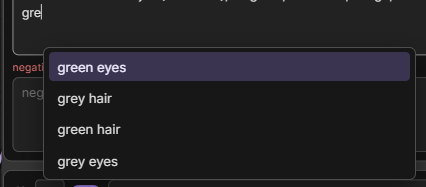
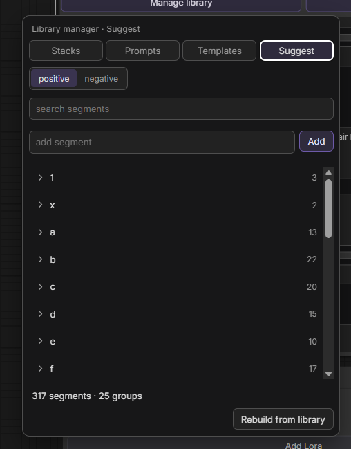

# Prompt Concatenate Pro

**Modular prompt library for ComfyUI — groups on the node, pairs on the shelf, presets for structure, templates for full looks.**

One node replaces a wall of text widgets. Split the prompt into **groups** (skin, lighting, outfit, background…), toggle and reorder them, and get two clean outputs: **`str_pos`** and **`str_neg`**.

Built-in **SQLite library** (no cloud, no external tag DB):

| Layer | What it stores | Typical use |
| ----- | -------------- | ----------- |
| **Preset** | Slot names + order only | Empty canvas: `Base · Scene · Character · Style` |
| **Template** | Full prompt pack (non-empty pairs) | Drop a look onto the node; merge by slot name |
| **Pair** | One pos/neg (+ notes) in a **group** shelf | Reuse “alisa…”, “sunset room…”, etc. |
| **Group** | Live card on the node | Edit, pin to sidebar, Save/Load pair |

**Manage library** covers Presets, Prompts, Templates, and (optional) Suggest — last opened tab and prefs persist in SQLite.

MIT — see [LICENSE](LICENSE) © StoneZol · [Changelog](changelog/CHANGELOG.md)



---

## Why Prompt Concatenate Pro?

| Without | With Prompt Concatenate Pro |
| ------- | --------------------------- |
| One giant positive string | Named groups you enable / disable / reorder |
| Re-paste the same skin / lighting every graph | **Save / Load pair** from a local library |
| Rebuild slot lists by hand | **Presets** = structure; **Templates** = filled packs |
| Favorites panel chaos | Pin **positive / negative** per group to the sidebar |
| Guess shelf names (`Scene255` vs `Scene 69`) | **Add group** lists library shelves you’ve already saved pairs into |

---

## Features

- **Group cards** — title, positive, negative, drag reorder, collapse, duplicate, enable toggle, **Clear**
- **Add group** — type a new name, or pick a library shelf that already has saved pairs (exact name)
- **Join engine** — merges enabled groups with `, `, skips empty, normalizes commas and spacing
- **Pin to sidebar** — `Group \| positive` / `Group \| negative` in Inputs / Favorites
- **Loaded tracking** — after Load, **Loaded ·** name (+ folder); notes / reload / detach; Save prefills from the chip
- **Presets** — slot names + order; folders; edit as comma-separated text in the manager
- **Templates** — full packs; load merges by slot name (insert missing, leave unrelated groups alone); empty pairs omitted on save
- **Prompt pairs** — save / load / append per group shelf; preview; **Search in prompts**
- **Smart search** — AND tokens; `shelf\keyword` filters a collection first
- **Library manager** — Presets / Prompts / Templates (+ **Suggest** when autocomplete is on); duplicate, rename, move, delete; last tab remembered
- **Prompt autocomplete** (experimental, Settings) — suggests segments from **your** library; caret popup (**Tab** accept); Suggest tab + rebuild
- **PNG-friendly prompts** — optional Settings: on queue, write joined text into stock CLIP `text`; wires restore after (off by default)
- **Local SQLite** — `db/presets.sqlite` (+ `db/autocomplete/` when Suggest is used)

---

## Install

1. Clone into `ComfyUI/custom_nodes/`:

    ```bash
    git clone https://github.com/StoneZol/prompt-concatenate-pro.git
    ```

2. Restart ComfyUI (or refresh the browser after a hot reload).

3. Add node: **`Prompt Concatenate Pro`**.

No pip dependencies — Python 3.8+ stdlib + SQLite only.

---

## Quick start

1. Add **Prompt Concatenate Pro** to the graph.
2. **Add group** — new name, or pick from **Groups**: library shelves that already contain saved pairs (not every card ever added on a node).
3. Fill positive / negative; connect **`str_pos`** / **`str_neg`** to two stock **CLIP Text Encode (Prompt)** nodes.
4. **Preset → Save / Load** — snapshot or restore the empty slot layout.
5. **Template → Save / Load** — ship or apply a full look (merge by slot name).
6. On a card: **Save / Load / Clear** pair; use **Loaded ·** reload / detach when linked.
7. **Manage library** — edit presets, prompts, templates; optional Suggest after enabling autocomplete in **Settings**.



### Save / load a preset

Snapshot slots (`Skin · Bg · Light`) into a named preset (optional folder). Load applies names + order only.


### Save / load a pair

From a group card: store or recall pos/neg under a **group** shelf (defaults to the card title). Search with `shelf\keyword`; preview before load; **+** appends instead of replace.


After load: **Loaded ·** chip — Save prefills; **×** detaches; reload pulls the last saved copy from SQLite.





### Templates

**Save template** stores non-empty pairs (+ Loaded pair meta). **Load template** keeps your node order, fills matching titles, inserts missing slots before the next already-present pack slot, and leaves groups that aren’t in the pack alone.





### Autocomplete (experimental)

**Settings → Prompt autocomplete**. While typing, suggestions from your library appear at the caret (**Tab** to accept). Manager **Suggest** tab: browse / edit / rebuild dictionaries (`db/autocomplete/`).





---

## Concepts

### Groups (on the node)

Live cards: `title`, `positive`, `negative`, order, `enabled`.  
Sidebar labels (`Skin | positive`) are stamped **when the group is created**. Renaming the card is local — it does **not** rewrite pin labels or rename library shelves.

### Presets (layout)

**Save preset** in the header. Slot names + order only (empty pairs). Optional **folder** (default **Uncategorised**). Planning canvas, not content.

### Templates (prompt packs)

**Save / Load template** in the header. Content packs merged **by slot name**. Use when a look should land on the node without wiping unrelated groups.

### Prompt pairs

**Save / Load pair** on a card. Live in a **group** shelf (collection). Title, notes, positive, negative.

### Folders vs group shelves

| Term | Used for | Table |
| ---- | -------- | ----- |
| **Folder** | Presets and Templates | `layout_folders` / template folders |
| **Group** (collection) | Prompt pairs | `categories` |

Shelves are created when you **Save pair**. Those with at least one pair show under **Add group → Groups** (so you can reuse exact names like `Scene255`).

---

## Pinning to the sidebar

Each group exposes two hidden STRING widgets:

- `Skin | positive`
- `Skin | negative`

Pin from the node **Inputs** panel or **Favorites**. Edits sync both ways with the card.

---

## Library manager

**Manage library** under the Preset / Template sections:

- **Presets** — layout by folder; rename / move / delete / **duplicate**; edit slots as `Base, Scene, …`
- **Prompts** — pairs by group shelf; full editor; **duplicate**
- **Templates** — packs; edit pairs (Save / Load / Clear, reorder, collapse); **duplicate**
- **Suggest** — autocomplete dictionary (when the Settings toggle is on)
- **Show empty** / **Search in prompts** — toggles; last opened tab + prefs in SQLite


---

## Settings

- **Embed prompts in CLIP for PNG meta** — on queue, write joined text into stock CLIP widgets (off by default so PNG-loaded workflows keep wires)
- **Prompt autocomplete** — experimental; enables caret suggestions + Suggest tab

---

## Join preview (debug)

In `js/pc/config.json`:

```json
"debug_join": true
```

Or in the browser console:

```js
localStorage.setItem("pc-debug-join", "1"); // on
localStorage.setItem("pc-debug-join", "0"); // off
```

Python also logs joined strings on execute (`[PromptConcatenatePro] str_pos …`). Turn debug off before release if you don’t need it.

---

## Known issues

- **Vue Nodes 2.0** — toggling Vue mode can briefly glitch layout on the canvas; refresh heals it. Widget data is fine.
- **Two installs** — two folders in `custom_nodes` ⇒ two nodes, two `presets.sqlite` files, conflicting routes. Keep a single copy.

---

## File layout

```
prompt-concatenate-pro/
├── nodes.py              # Join logic, node class
├── routes.py             # REST API for library
├── db/
│   ├── db.py             # SQLite CRUD
│   ├── presets.sqlite    # created at runtime
│   └── autocomplete/     # letter DBs when Suggest is used
├── js/
│   ├── prompt_craft.js   # Node UI entry
│   └── pc/               # Dialogs, manager, autocomplete, API
├── changelog/
│   └── CHANGELOG.md
└── docs/screenshots/
```

---

## Links

- Repository: https://github.com/StoneZol/prompt-concatenate-pro
- Changelog: [changelog/CHANGELOG.md](changelog/CHANGELOG.md)
- ComfyUI Registry: **Manager** → search **Prompt Concatenate Pro**

---

**If Prompt Concatenate Pro saves you time, star the repo — it helps others find it.**
