# Changelog

All notable changes to **Prompt Concatenate Pro** are documented here.

Format: newest first.

---

## [2.4.0] — 2026-11-22

### Pair preview images

- Attach a reference image to a saved pair (character / scene / light / …)
- Paste from clipboard on **Save pair** and **Edit prompt** — small thumb in the dialog; paste again to replace; Clear removes it
- Files live under `db/previews/` next to SQLite; the pair stores only a relative path (rename keeps the image)
- Deleting a pair (or its collection) removes the preview file
- Hover preview icon: **Load pair** (beside the name), **Loaded ·** chip (after Loaded, before the name), Library manager prompt rows

---

## [2.3.0] — 2026-11-21

### Pair browse (optional)

- Settings · SQLite: **Pair browse** (off by default) — flip through saved pairs right on the node card
- **‹ ›** in the Loaded row step to the previous / next pair under the browse folder, **including sub-folders** (e.g. `Scene` → `Scene/Walk` → …; same order as Load pair); hidden when fewer than two pairs are in scope
- Counter after the name: **Loaded · name · 38/45** (position / pairs in the folder tree)
- Nothing loaded → **› Browse** opens a folder picker (incl. empty parents that only have pairs in sub-folders), then starts from the first pair in that scope
- Browse root is remembered on the group: Load a pair inside the scope keeps it; a pair outside raises the root to that pair’s folder
- Replace confirm follows **Skip pair overwrite confirms** (asked only if the pair has text)

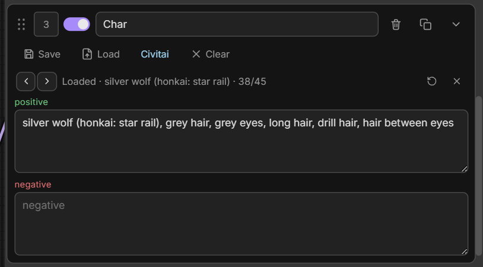

### Nested collections / folders

- Paths with `/` for pair collections **and** preset / template folders: `Scene/Walk`, `Looks/Portrait` — as deep as you like; folders appear on first save
- A name with `/` is also a path: `Looks` + `Portrait/Soft` saves as collection `Looks/Portrait`, name `Soft` (same for presets / templates)
- Type the path by hand (sub-folder hints after `/`, **Tab** completes) or **Choose** → folder browser: crumbs, sub-folders with counts, filter, **+ New folder** (Save only; Browse for flipping has no create)

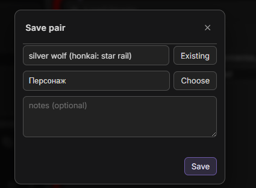

- **Load pair** opens the group’s root collection (or the loaded pair’s folder) with crumbs + sub-folders; search covers the subtree; `Scene/Walk\rain` or `looks\port\` filters by path
- Manager · Prompts / Presets / Templates are trees; **Rename** takes a full path (move a branch), **Delete** removes the branch

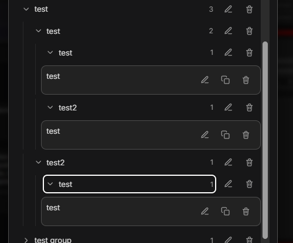

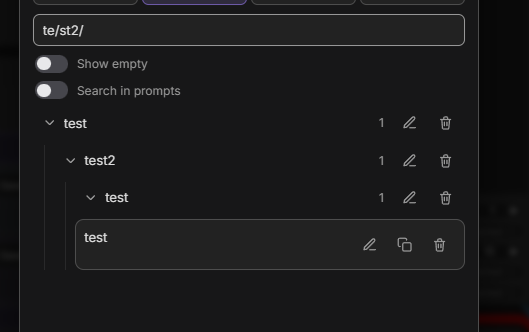

- **Add group** lists root collections only
- Migration on first start: folder / collection names that already contained `/` become `|` (`A/B` → `A|B`); then names like `Studio/Soft` are split into folder + leaf so existing libraries nest correctly
- Templates and presets are unique per **folder + name** (same as pairs per collection) — `soft-light` can live in `Studio` and in `Looks` at once

### Save over existing

- Save pair / Save preset / Save template: **Existing** next to the name — pick an already saved name (grouped by collection, filterable) to overwrite it; notes prefilled if empty
- After a pick the button turns into **Overwrite** (danger); changing the name or collection resets it
- Same picker in the manager’s **Edit** dialogs (pair / preset / template); manual rename is re-checked on save — if the name is taken you get a warning and an explicit **Overwrite**
- Uniqueness: pairs by collection + name; presets and templates by folder + name

### Templates: replace or merge

- Load template card has two actions: **Load** — full swap of the node’s pairs (confirm if any pairs exist; External stays in place), **+** — merge by slot name (previous behaviour)

### Library toggles

- Settings · SQLite: **Presets** and **Templates** — turn off to hide those sections on the node and their tabs in the manager (on by default)

### Bulk actions

- Add group row: **Clear all** (✕) empties every pair’s prompts + loaded names, **Remove all** (trash) deletes all groups (External kept); both confirm first

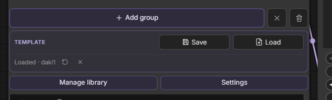

### What's new popup

- First time a Prompt Concatenate Pro node opens on a new package version, a short **What's new** dialog shows the current release notes (Got it + link to the full GitHub changelog)

> New settings keys need a full ComfyUI restart after update (then Ctrl+F5).

---

## [2.2.0] — 2026-11-08

### Civitai Toolkit LoRA import (experimental)

- Settings · SQLite: **Civitai Toolkit LoRA import** — **Civitai** on each pair (node, Edit prompt, Edit template)
- Overlay browser (closes only via **X**): folder browse from LoRA paths (loader-style crumbs) + search in current folder (name / file / tag / base)

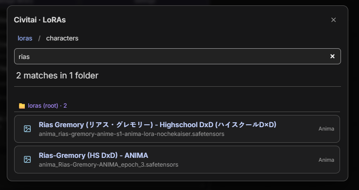

- Click LoRA title → **Info**: cover/meta, Civitai tags, selectable trigger groups (hard-capped), **Append** / **Replace** into positive; description (collapse) + on-demand sidecar notes + Civitai page link

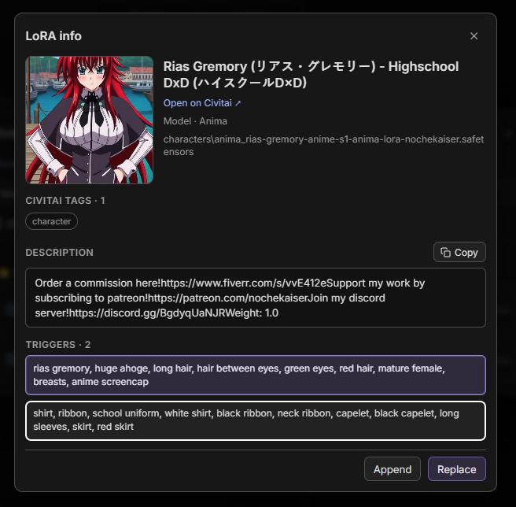

- Soft dependency on [ComfyUI-Civitai-Toolkit](https://github.com/BAIKEMARK/ComfyUI-Civitai-Toolkit) (works without it; overlay explains if missing; Settings help links the repo)

### Pair / library UX

- **Remove group** in the card head between title and Duplicate (node + Edit template)
- Load pair: prefer the pair’s **loaded** category shelf first
- Prompt autocomplete also in Edit prompt / Edit template when Suggest is on
- Popups / Suggest / autocomplete stacking polish (blocking overlays, AC above dialogs)

---

## [2.1.0] — 2026-11-07

### Settings: this node vs saved

- Settings split into **This node** (per instance, in `blocks_data`) and **Saved · SQLite** (all nodes)
- This node: **Embed prompts in CLIP for PNG meta**, **External prompt**
- Saved: **Skip pair overwrite confirms**, **Prompt autocomplete** (no longer marked experimental)

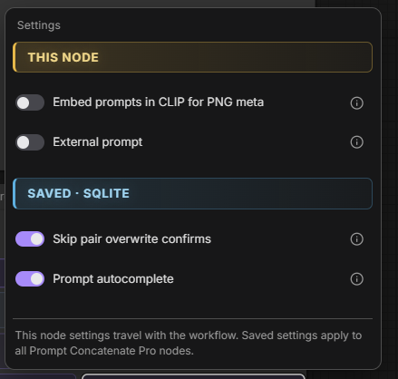

### External prompt slot

Wire any STRING prompts into the builder as a first-class pair: reorder, enable/disable, no library Save/Load.

- Per-node toggle **External prompt** — **External** card + `external_pos` / `external_neg` inputs; values visible in the Comfy console print on run

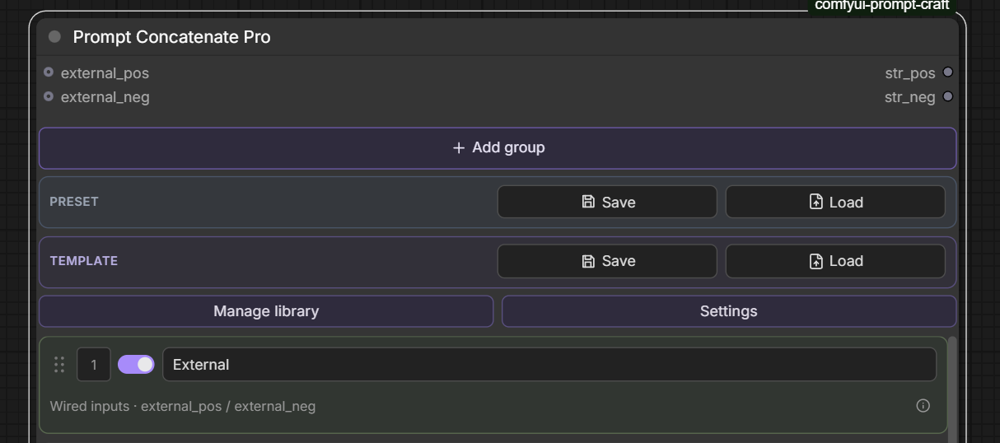

- Presets/workflows store External’s position (fixed id); loading them restores External on that node
- Templates ignore External (not saved into packs)

### Pair UX

- Positive / negative textareas remember their resized height in the node’s `blocks_data` (survives workflow switches; saved only on user resize, not on layout reflow)
- Settings: **Skip pair overwrite confirms** — Load pair replace + Clear pair without dialogs (off by default)
- Autocomplete: when longer matches exist but the typed segment is new (`sweet` vs `sweet dreams`), an **Add** row appears at the bottom — Tab saves it to the dictionary

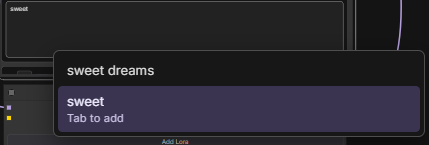

---

## [2.0.0] — 2026-10-17

### Templates, autocomplete, library polish

**Presets** stay the empty planning canvas (slot names only). **Templates** are full prompt packs you drop onto a node — pose / light / camera filled, character left alone if it wasn’t in the pack. Plus experimental **prompt autocomplete** from your own library.

#### Templates

- Node: **Preset** and **Template** sections — label + Save/Load on one row; **Loaded** chip (notes / reload / detach) under each

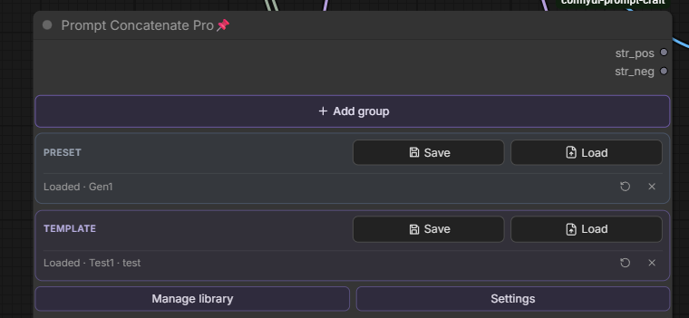

- Load by slot name: keep the node’s order; fill matching pairs; insert missing slots before the next already-present template pair (not always at the end); ignore pairs that aren’t in the template
- Empty pairs are not saved; **Loaded** pair chips travel with the pack
- Manager: **Templates** tab — folders, edit pairs (add / remove / reorder / collapse, Save / Load / Clear pair, enable / disable), duplicate / delete; **Add pair** uses the same group-shelf picker as **Add group**

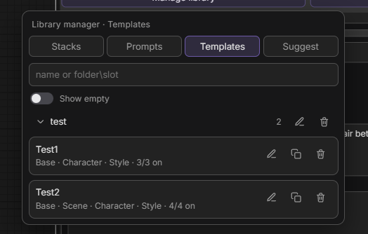

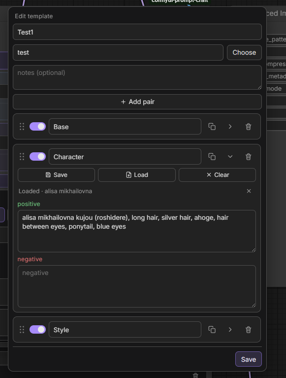

- Saving a template also feeds autocomplete dictionaries

#### Prompt autocomplete (experimental)

Suggest tags/phrases from **your** library while editing positive / negative — not from an external tag DB.

- **Settings**: toggle **Prompt autocomplete** (off by default) with an `experimental` badge
- When enabled: Library manager gets a **Suggest** tab — segments grouped by letter (collapsible); search expands matching groups; add / edit / delete / **Rebuild from library**

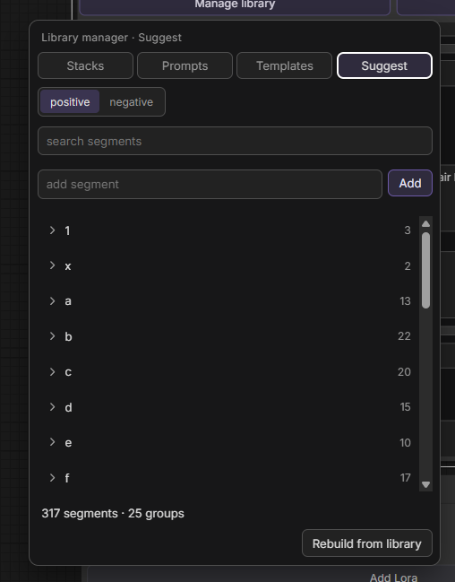

- **Edit** a segment: rename in that side’s dictionary (pos or neg only); if presets use it, confirm then rewrite those prompts on that side only
- **Edit** replace preview: count + scrollable cards (collection, name, info peek)

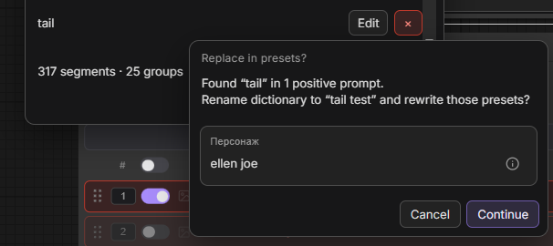

- Dictionaries live under `db/autocomplete/{pos,neg}/` — one SQLite file per first letter (dynamic)
- Segments split on `,` and newlines; `(tag:1.2)` weights stripped on ingest
- VS Code-style popup at the caret: arrows to move, **Tab** to accept, **Esc** to close (Enter still inserts a newline)
- Scrollable suggestion list (max height); lookup stays inside the letter bucket
- If nothing matches: popup offers the typed segment with **Tab to save**; after save the hint turns green **Saved** (~1.5s or until next input)

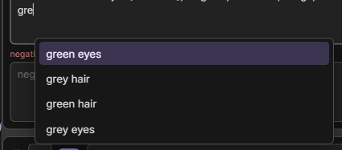
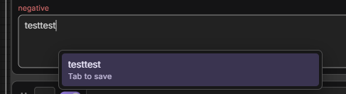

- Saving or updating a pair also feeds the dictionaries

#### Preset & pair UX

- After Load: **Loaded ·** name (+ folder), reload / detach; Save prefills from the chip
- Preset chip clears when you add, remove, or duplicate a group
- Pair toolbar: **Clear** next to Save / Load (clears pos / neg + Loaded chip)

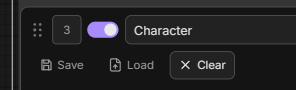

- **Add group**: type a new name as before, or pick a library shelf that already has saved pairs (exact name)

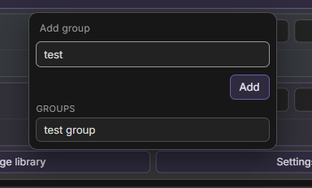

- Library manager: **Stacks** renamed to **Presets**; last opened tab remembered in SQLite

---

## [1.5.0] — 2026-10-16

### Reload the loaded pair

Edited a loaded pair and want the library version back? No need to open Load again.

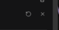

- **Loaded** row: **reload** fetches the pair from the library by name/shelf and restores positive / negative / notes
- No local snapshot — always the last saved copy in SQLite
- If the pair was renamed or deleted, a short alert explains why reload failed

---

## [1.4.0] — 2026-09-13

### Settings, append load, and notes at a glance

Everyday library use gets less friction: optional PNG meta is behind a toggle, you can append pairs instead of only replacing, and saved notes are one click away on the Loaded row.

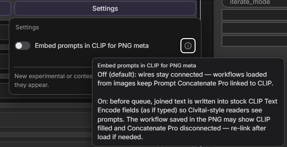

- **Settings** on the node: **Embed prompts in CLIP for PNG meta** (SQLite `embedClipMeta`, **off** by default)
- When the toggle is on: before queue, joined text is written into stock CLIP `text` widgets; wires restore after (workflows from PNGs stay linked when off)

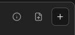

- **Load pair**: **+** appends the pair to the end of the cell (join with `, `); clears the Loaded chip (cell is no longer a single preset)
- Load / file-up still **replaces** (confirm if the cell is not empty)
- Icons refreshed: replace = **file-up**, prompt / notes preview = **info**

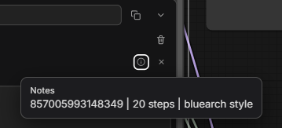

- **Loaded** row: **info** opens saved **notes** when present — no need to open Save just to read a seed or memo

---

## [1.3.0] — 2026-09-09

### PNG prompts that look like stock CLIP

Joined `str_pos` / `str_neg` can land in image metadata the way Comfy readers expect — as literal `text` on two stock **CLIP Text Encode (Prompt)** nodes.

- On queue (when enabled), Prompt Concatenate Pro writes joined prompts into connected CLIP `text` widgets, then restores the wires
- Uses only official widget hooks (`beforeQueued` / `afterQueued`) — no `graphToPrompt` hijack
- Wire **`str_pos`** / **`str_neg`** → positive / negative **CLIP Text Encode**; KSampler stays on those CLIP nodes

### Removed

- **Prompt CLIP Encode** (dual encode helper) — it needed fragile prompt mirroring to look like stock CLIP in PNG meta. Prefer two stock CLIP Text Encode nodes instead. Existing workflows that used this node need to reconnect.

---

## [1.2.0] — 2026-08-27

### Library search, loaded pairs, and simpler stack edits

Working with a growing prompt library is less friction: find what you need faster, keep track of what you loaded, and tweak stacks without a full overwrite dance.

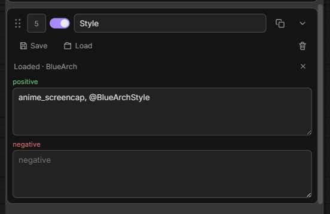

- After **Load pair**, the group shows **Loaded · name** with an **×** to detach (prompt text stays)
- **Save pair** prefills name, collection, and **notes** from the loaded source
- Load / manager search: AND tokens; optional `shelf\keyword` (or `/`) filters collections first
- **Search in prompts** toggle (off by default) — body text only when you ask for it
- **Other collections**, **Show empty**, and **Search in prompts** preferences persist in SQLite
- Empty shelves no longer leak into search results when **Show empty** is on
- Load dialogs stay on screen (reposition after content loads; flip above the button if needed)

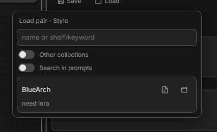

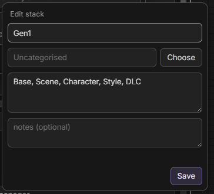

- **Edit stack** can change slots in one text field (`Base, Scene, Character, …`)
- UI copy uses **notes** instead of “description” for the optional memo field
- Library manager: **Duplicate** on stacks and prompts (`Name` → `Name (2)`) to fork a version

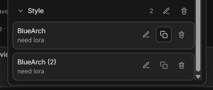

---

## [1.1.1] — 2026-08-16

### Library manager folders stay readable

With many collections open at once the list was hard to scan, and any reload (delete / rename) forced everything open again.

- Folders and collections default to **collapsed**
- Expand/collapse is remembered while the manager stays open
- Delete, rename, and list refresh no longer re-expand everything you closed
- Search still temporarily opens matching sections; clearing the query restores your fold state

---

## [1.1.0] — 2026-08-16

### Duplicate pair on the node

You can stack several complementary prompts from the same library shelf without merging them into one field.

- **Copy** button on each group card (after the title, before collapse)
- Creates a new group **directly under the source** (same positive / negative / enabled) — no scrolling the whole stack, no clever insert rules
- Title gets a numeric suffix: `Pose` → `Pose (2)` → `Pose (3)`
- Each copy has its own id and sidebar pin labels (`Pose (2) | positive`), so Favorites stay distinct
- **Save pair** / **Load pair** normalize the title: strip trailing ` (N)` and use the base name as the collection (`Pose (2)` → shelf **Pose**)
- Join order stays under your control via drag / priority; auto-numbering is only the title, not list position
- Existing workflows and library data from 1.0.x are unchanged; plain titles still map 1:1 to shelves

---

## [1.0.0] — 2026-08-14

Initial release:

- Modular prompt groups with join to `str_pos` / `str_neg`
- Sidebar pinning for per-group positive / negative
- Layout presets (stacks) and prompt pairs with SQLite library
- Library manager (rename / move / delete / edit)
